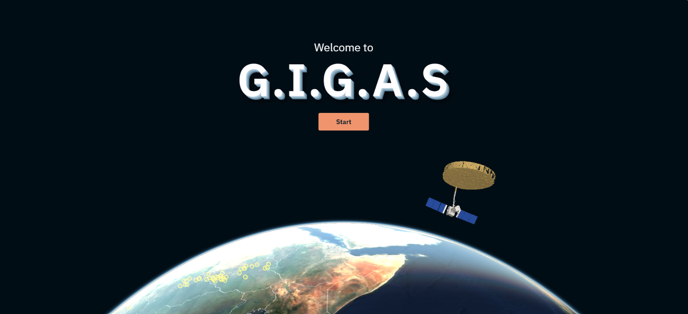
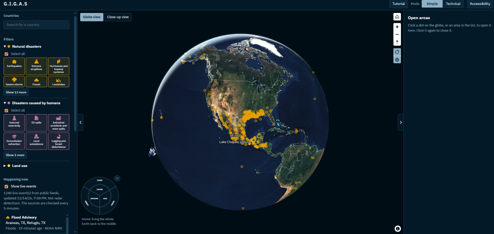
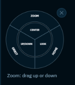
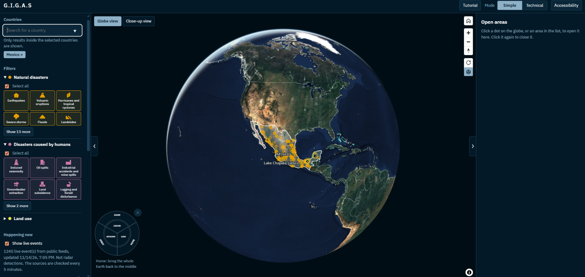
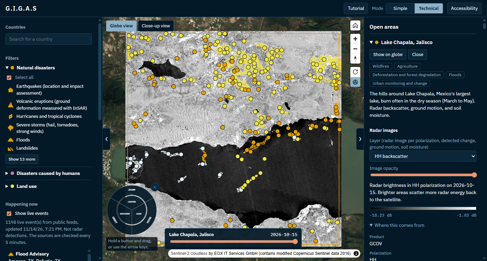
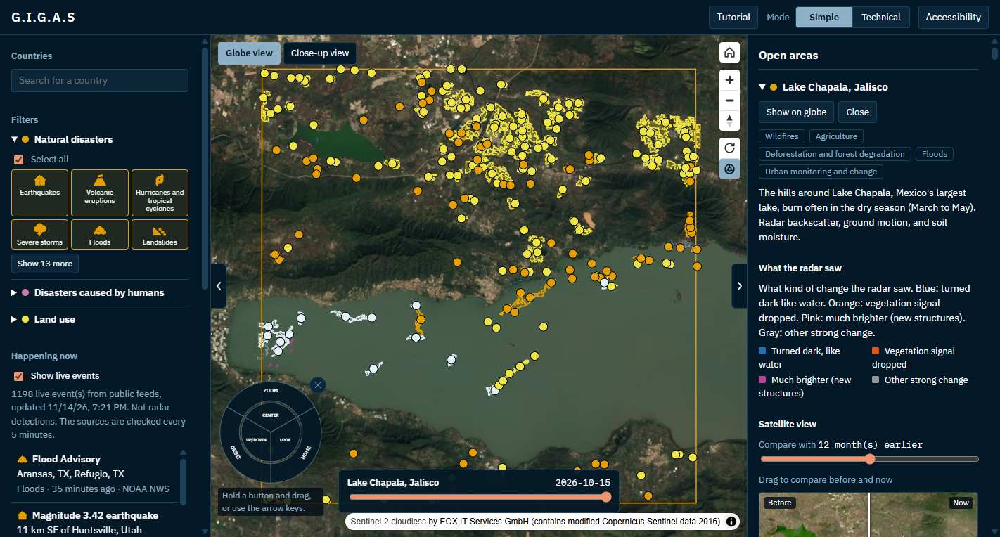
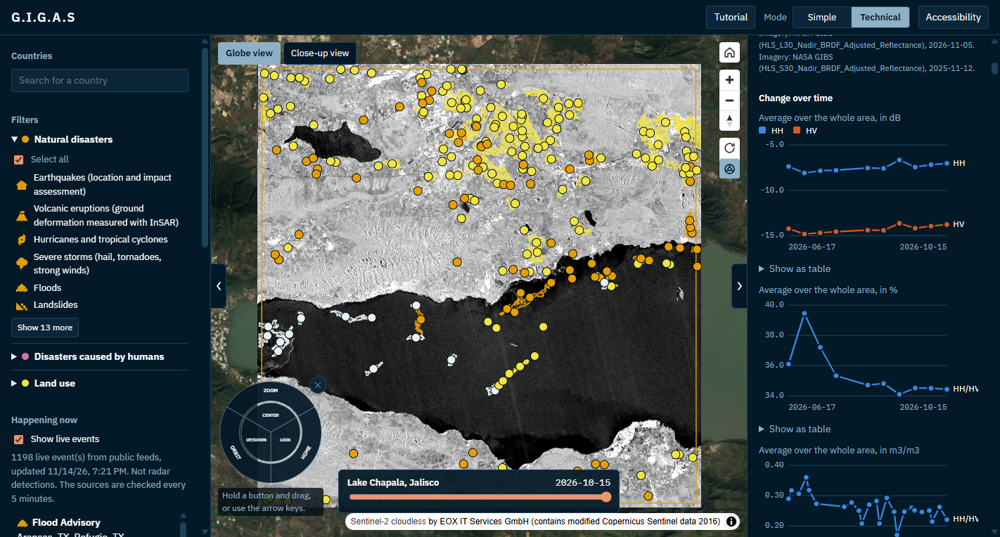
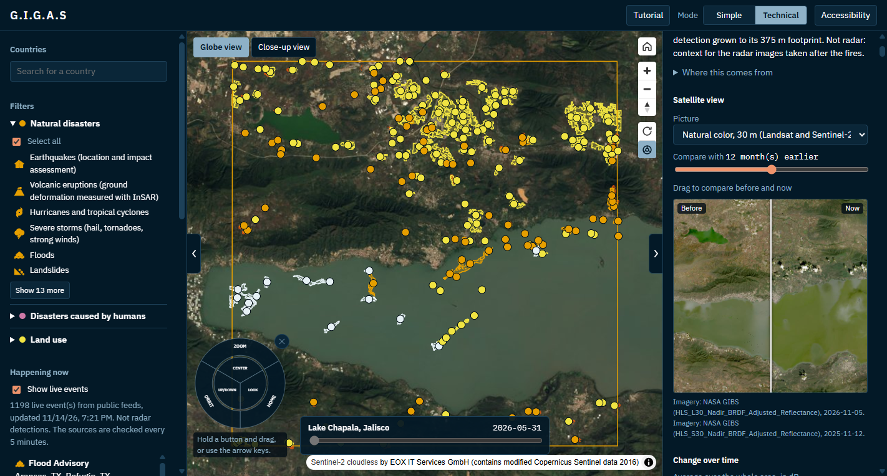
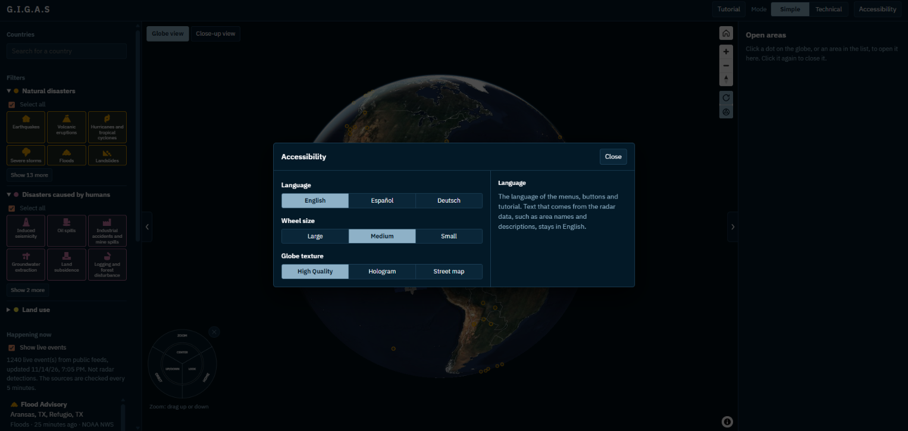

# G.I.G.A.S: Global Interactive Geographical Analytics System

<p align="center">
  
</p>

Team: [Borrenautas](https://www.spaceappschallenge.org/2026/find-a-team/borrenautas/?tab=members)

Challenge: [Dancing with the SARs](https://www.spaceappschallenge.org/2026/challenges/dancing-with-the-sars/), NASA International Space Apps Challenge 2026.

G.I.G.A.S (Global Interactive Geographical Analytics System) is an open-source web app that shows how the Earth's surface changes, as seen by the NISAR radar satellite, on an interactive 3D globe. A back end turns NISAR radar products into map layers and typed change events (floods, forest loss, sinking ground, soil drying). The globe shows them next to live disaster events from official public sources, in plain words for the public and with full technical detail for scientists.

## Map of Contents

1. [About the project](#about-the-project)
2. [Background](#background)
3. [Who it is for](#who-it-is-for)
4. [Video and demo](#video-and-demo)
5. [The web application](#the-web-application)
6. [Features](#features)
7. [Live events: sources and update times](#live-events-sources-and-update-times)
8. [The NISAR pipeline (back end)](#the-nisar-pipeline-back-end)
9. [Architecture](#architecture)
10. [How to run it](#how-to-run-it)
11. [NASA data and other sources](#nasa-data-and-other-sources)
12. [What is real and what is not](#what-is-real-and-what-is-not)
13. [Known limits](#known-limits)
14. [Future](#future)
15. [File descriptions](#file-descriptions)
16. [Languages, frameworks and other technologies](#languages-frameworks-and-other-technologies)
17. [Use of AI](#use-of-ai)
18. [License](#license)
19. [Team members and their contributions](#team-members-and-their-contributions)

## About the project

Submission for the challenge [Dancing with the SARs](https://www.spaceappschallenge.org/2026/challenges/dancing-with-the-sars/) (event: November 14-15, 2026).

The Earth's surface is always changing: wetlands flood and dry, forests are cleared or burn, cities sink as groundwater is pumped out, fields change with the seasons. Radar satellites see these changes day and night and through clouds, but radar images are hard to read without training.

G.I.G.A.S makes that data readable:

- A **3D globe** you can spin, zoom and search by country or coordinates.
- **Radar areas**: places processed from NISAR data, each with its radar pictures over time, the changes detected, a chart, and where every image comes from.
- **Live events**: what is happening on Earth right now (earthquakes, fires, floods, storms, volcanoes and more), from official sources, always labelled as *not* radar detections.
- **Two modes**: *Simple*, in plain words, and *Technical*, with every layer, measurement and provenance record.

The hackathon demo covers Mexico with three case-study sites; the design is global.

## Background

NISAR (NASA-ISRO Synthetic Aperture Radar) is a radar satellite from NASA and ISRO. A radar sends its own microwave pulses and measures what comes back, so it works at night and through clouds. What comes back depends mostly on how rough the surface is and how much water it holds. That makes radar good at seeing floods (open water turns dark), forest loss (the signal from tree canopies drops), new buildings (bright corners), and ground that rises or sinks by centimetres between two passes.

The challenge asks for an interactive application that uses NISAR data to track and visualize one or more types of surface change, with intuitive tools that make the data understandable to a broad audience.

## Who it is for

| User | What they get |
|---|---|
| Public and educators | Simple mode: plain words, one picture per place chosen by the app, a guided tutorial, three languages |
| Resource managers and decision-makers | Where and when change happened, how big, how confident the detection is, and what is happening live nearby |
| Scientists | Technical mode: every layer and polarization, value ranges, time series, and full provenance (granules, product, maturity, parameters) |

## Video and demo

- Demo video: awaiting video
- Live site: awaiting site link

## The web application

The app opens on a welcome screen: the name over the Earth's horizon, slowly turning. Pressing **Start** sends the letters round the Earth and behind it while the camera pulls back to the whole globe and the panels slide in. The house button brings you back.

The screen has three parts:

- **Left panel**: country search, filters by type of change, live events ("Happening now"), coordinates (Technical mode) and the list of radar areas.
- **The globe**: one map that is a globe when zoomed out and a flat map when zoomed in.
- **Right panel**: the areas you opened, stacked as tabs.

<p align="center">
  
</p>
<p align="center">The globe with live events over North and Central America, in Simple mode.</p>

## Features

### The globe

- **Globe and close-up views.** The close-up view is a low, tilted camera with the horizon in sight. Switching views keeps your zoom.
- **Auto-rotate**, a **view wheel** (Zoom, Orbit, Look, Up/Down, Center, Home; works with mouse, touch and arrow keys) and a **home** button, as square buttons beside the zoom buttons.

<p align="center">
  
</p>
<p align="center">The view wheel.</p>

- **Three looks** for the Earth: High Quality (cloud-free Sentinel-2 mosaic, sharp down to city blocks), Hologram (dark outline map) and Street map.
- **An orbiting satellite** as a decoration. Its orbit has NISAR's tilt, but its position, height and size are not real, and the tutorial says so.
- **Side panels** can be pushed off screen and pulled back with the arrows on the globe's edges.

### Finding things

- **Country search.** Pick one or more countries: they are outlined on the globe, and the area list, the detected changes and the live events keep only what lies inside them.

<p align="center">
  
</p>
<p align="center">Mexico selected: only what lies inside the country stays on the globe.</p>

- **Filters by type**, in three groups (natural disasters, disasters caused by humans, land use), each type with its own icon. Everything on the globe follows the filters.
- **Go to coordinates** (Technical mode): fly to a latitude and longitude. **Process** asks the back end to analyze that place.

### Radar areas

Clicking a dot or a list row opens the area as a tab:

- **Radar pictures** with a **date slider at the bottom of the globe** and an opacity control. In Technical mode you choose the layer (backscatter per polarization, detected change, ground motion, soil moisture); in Simple mode the app picks the most telling one.
- **A color key** for every picture and a plain description of what it shows.
- **"Where this comes from"**: product, polarization, data maturity, source granules, processing steps, parameters, software and credit.
- **Change over time**: a line chart per unit with a hover readout and a table view.
- **Timeline** of radar passes and detected changes, with a confidence figure in Technical mode.
- **Satellite before/now**: a swipe comparison of optical satellite pictures from NASA GIBS (Landsat/Sentinel-2 at 30 m, or daily VIIRS), from 1 month to 10 years apart.

<p align="center">
  
</p>
<p align="center">Technical mode: Lake Chapala, Jalisco, with the HH radar picture of 2026-10-15, its color key and where it comes from.</p>

<p align="center">
  
</p>
<p align="center">Simple mode: the same place in plain words.</p>

<p align="center">
  
</p>
<p align="center">Change over time: the radar signal of the whole area, date by date.</p>

<p align="center">
  
</p>
<p align="center">Satellite before/now (NASA GIBS): Lake Chapala a year apart.</p>

### Live events ("Happening now")

- Hollow rings on the globe and a list that says **what, where, how long ago, and who reported it**. Clicking a row flies there and opens the details with a link to the source.
- The page asks the sources itself **every 15 minutes**, so it works wherever it is opened, with no server. New events appear and expired ones leave without a reload.
- See [the next section](#live-events-sources-and-update-times) for the sources.

### For everyone

- **Simple and Technical modes**, switched in the header with an animated cross-fade.
- **Three languages**: English, Spanish and German.
- **Guided tutorial** on the first visit and from the Tutorial button.
- **Accessibility**: full keyboard use, screen-reader labels, color never used alone (types are always named and have icons), a colorblind-safe palette for the filter groups and charts, and reduced motion respected throughout (animations become fades or stop).
- **Honesty notices**: a banner whenever example places or synthetic test data are on screen.

<p align="center">
  
</p>
<p align="center">The accessibility menu.</p>

## Live events: sources and update times

Only official sources are used, and every event names its source.

| Source | Types it feeds | Coverage |
|---|---|---|
| U.S. Geological Survey, Earthquake Hazards Program | Earthquakes (M2.5+); also landslides, collapses, ice quakes and human-caused shaking when its network records them | World |
| GDACS (United Nations OCHA and European Commission JRC) | Tropical cyclones, floods, volcanoes, drought, wildfires | World |
| NASA EONET (Earth Observatory Natural Event Tracker) | Wildfires, severe storms, volcanoes, sea ice, dust, heat and cold, and others | World |
| NOAA National Weather Service alerts | Storms, hurricanes, floods, heat, cold, dust, fire weather, marine hazards, and watches ("Forecast") | United States |
| U.S. Geological Survey, Volcano Hazards Program | Volcanoes at a raised alert level | United States |
| NOAA National Hurricane Center, NASA FIRMS fire detections | Tropical cyclones, fire hot spots | Only through the back end (see [Known limits](#known-limits)) |

**When an event leaves the globe:** a moment in time (an earthquake, a fire detection) after 24 hours; an event its source still lists as going on (a flood, a drought, a weather alert, a restless volcano) when the source stops listing it.

**No live source exists** for the slow changes (subsidence, groundwater extraction, logging, coastal land loss, permafrost, ice sheets). Those are exactly what the NISAR radar areas are for.

## The NISAR pipeline (back end)

<!-- Written from backend/README.md and docs/ on main. Back-end lane: please check this section. -->

The back end (`backend/`, Python) turns NISAR granules into the map layers and change events the globe shows. It uses three NISAR products, all NASA data:

| Product | What it measures | Used for |
|---|---|---|
| **GCOV** (L2, 10 m, HH and HV backscatter) | How bright the surface is to the radar | Surface type; floods, forest or vegetation loss, new structures, crops |
| **GUNW** (L2, 80 m, unwrapped interferograms) | Ground motion between two passes (cm) | Subsidence |
| **SME2** (L3, about 200 m) | Soil moisture | Soil drying (a drought signal) |

Steps, per site:

1. **Select** granules with `asf_search` (same viewing geometry, never mixing data maturities).
2. **Read** only the site's window over HTTPS, never whole 2-7 GB files.
3. **Detect** change signatures (for example: both polarizations darken to open-water levels; HV drops over vegetation; line-of-sight motion over 5 cm per year).
4. **Classify** them into typed events with a confidence figure and a plain-language summary.
5. **Export** the contract files the globe reads: manifest, layers, time series, events.

Case-study sites (Mexico): Hopelchén, Yucatán (deforestation), Villahermosa (floods), Chapala (wildfires), plus Mexico City (subsidence) and a country-wide soil-moisture mosaic.

**Which polarizations show the change:** HH responds most to surface roughness and to water (floods darken it); HV responds to volume scattering in vegetation, so a drop in HV larger than in HH points to canopy loss. The app lets you switch between them in Technical mode.

## Architecture

```
NISAR products (ASF DAAC, NASA Earthdata)
        |  select + stream only the needed window
        v
backend/  (Python): select -> read -> detect -> classify -> export
        |  manifest, layers, time series, events  (data contracts, docs/04-contracts.md)
        v
frontend/ (Vite + TypeScript + MapLibre GL JS)  <---  public live feeds (USGS, GDACS, NASA EONET, NOAA NWS)
        |                                       <---  NASA GIBS (before/now pictures), Sentinel-2 cloudless tiles
        v
the browser: globe, panels, charts
```

- The two halves meet **only at the data contracts**, so each can be built and tested alone.
- **Static first:** the app runs from plain files. A server is needed only to process a new place on request and to push updates.
- **Provenance everywhere:** every layer carries its granules, product, maturity and parameters.

## How to run it

**Front end** (needs Node.js):

```
cd frontend
npm ci
npm run dev       # http://localhost:5173
npm test          # unit tests
npm run build     # type-check + static build into dist/
```

Without a back end the app still runs: it shows example places (labelled as examples) and live events.

**Back end** (needs [uv](https://docs.astral.sh/uv/) and a NASA Earthdata token in `backend/.env`):

```
cd backend
uv run sars-pipeline run            # select and process every site
uv run sars-pipeline serve          # API on http://127.0.0.1:8765/
```

Details: `frontend/README.md`, `backend/README.md`.

## NASA data and other sources

**NASA data**

- **NISAR** GCOV, GUNW and SME2 products (NASA/JPL-Caltech and ISRO, distributed by the Alaska Satellite Facility DAAC). The exact granules behind every layer are listed in its provenance.
- **NASA GIBS** (Global Imagery Browse Services): before/now optical pictures.
- **NASA EONET**: live natural events.
- **NASA FIRMS**: fire detections (back end).

**Other sources**, each credited in the app:

- USGS (earthquakes, volcano alert levels), NOAA (weather alerts, hurricanes), GDACS (United Nations and European Commission).
- Globe imagery: Sentinel-2 cloudless by EOX IT Services GmbH (contains modified Copernicus Sentinel data 2016), CC BY 4.0.
- Street map: © OpenStreetMap contributors (ODbL). Outline map: MapLibre demo tiles.
- Country outlines: Natural Earth (public domain).
- Typefaces: IBM Plex Sans and IBM Plex Mono (SIL Open Font License 1.1).
- Satellite model: generated by the team with Meshy from the NASA/JPL-Caltech illustration "NISAR in Orbit (Artist's Concept)", PIA26613.

The full list with DOIs and licenses is in `docs/09-references.md`.

## What is real and what is not

The project's rule is that nothing synthetic is ever shown as real.

- **Example places** appear only while no radar data is connected, and are labelled as examples.
- **Synthetic test data** carries a banner and a tag on every area that uses it.
- **Live events** are labelled "not radar detections" and each names its source.
- **The orbiting satellite** is an illustration, and the tutorial says so.
- **Detections are not validated on the ground.** Each carries a confidence figure, and the detection rules are documented in `backend/README.md`.

## Known limits

- **Two live sources need the back end:** NOAA's hurricane center does not accept requests from web pages, and NASA FIRMS needs a key. Tropical cyclones still arrive through GDACS.
- **Weather alerts and volcano alert levels cover the United States only.**
- **Country filter:** outlines are coarse (1:110m), so a point just off the coast counts as outside, and the smallest countries are missing.
- **Translations** (Spanish, German) are machine-written and not yet checked by native speakers.
- **Not yet checked:** a real phone, browsers other than Chrome, a screen reader.
- **Public tile servers** (OpenStreetMap, EOX) are for light use; a hosted tile service is needed before real traffic.

## Future

- More radar areas beyond Mexico, and ground-motion figures for dams, levees and sinking cities.
- A before/after swipe directly on the radar pictures.
- A date and confidence filter for detected changes.
- Live sources for more regions (weather alerts outside the United States).
- Native-speaker review of the translations, and more languages.

## File descriptions

| Path | What it holds |
|---|---|
| `frontend/` | The web app |
| `frontend/src/main.ts` | The page: panels, filters, areas, live events, welcome screen |
| `frontend/src/globe.ts` | The MapLibre globe, its layers and camera |
| `frontend/src/livefeeds.ts` | Live events fetched from the public sources |
| `frontend/src/satview.ts` | Before/now satellite pictures from NASA GIBS |
| `frontend/src/satellite.ts` | The orbiting satellite (WebGL custom layer) |
| `frontend/src/filters.ts`, `icons.ts` | Types of change, their groups, colors and icons |
| `frontend/src/i18n.ts` | Every interface text in English, Spanish and German |
| `frontend/src/chart.ts`, `wheel.ts`, `tour.ts`, `settings.ts` | Chart, view wheel, tutorial, accessibility menu |
| `frontend/src/logic.ts`, `frontend/test/` | Pure logic and its unit tests |
| `backend/` | The NISAR pipeline and the data server |
| `docs/` | Challenge text, product spec, architecture, data contracts, references |
| `specs/` | Feature specs with acceptance criteria |

## Languages, frameworks and other technologies

- **Front end:** TypeScript, Vite, MapLibre GL JS (globe projection), WebGL, plain DOM and CSS (no UI framework), Node's built-in test runner.
- **Back end:** Python, uv, `asf_search`, `h5py` + `fsspec`, pytest, ruff.
- **Hosting (back end):** Microsoft Azure (virtual machine and Blob Storage), Docker Compose, Caddy.
- **Data services:** NASA Earthdata / ASF DAAC, NASA GIBS, NASA EONET, NASA FIRMS, USGS, NOAA, GDACS.

## Use of AI

Two AI tools were used. **Claude** (Anthropic) wrote code under the team's direction and review, and wrote the Spanish and German interface texts. **Meshy** generated the satellite 3D model from NASA/JPL-Caltech's illustration of NISAR. No AI-generated images, audio or video are shown as data, and no data is invented: see [What is real and what is not](#what-is-real-and-what-is-not).

## License

<!-- TODO (team): add a LICENSE file. Space Apps requires an open-source (OSI) licence; Apache 2.0 applies if none is given. -->

## Team members and their contributions

| Name | Role |
|---|---|
| Diego de Silva Hernandez | Front-end development |
| Adrian Madrid Castro | Front-end development |
| Hector Lerma Scott | Back-end development |
| Jose Pablo Mendez Espino | Back-end development |
| Samuel Andre Rivera Dominguez | Documentation |

<!-- TODO (team): GitHub profile links, and a team photo if you want one. -->
