# G.I.G.A.S: Global Interactive Geographical Analytics System

<p align="center">
  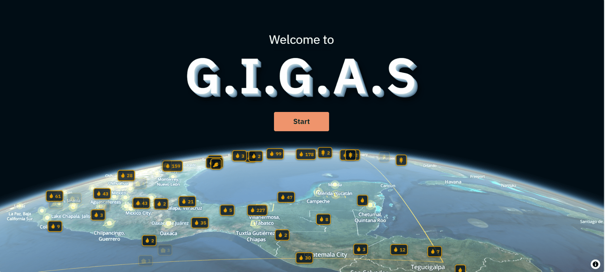
</p>

Team: [Borrenautas](https://www.spaceappschallenge.org/2026/find-a-team/borrenautas/?tab=members)

Challenge: [Dancing with the SARs](https://www.spaceappschallenge.org/2026/challenges/dancing-with-the-sars/), NASA International Space Apps Challenge 2026.

Live site: **[gigas.earth](https://gigas.earth)**

G.I.G.A.S (Global Interactive Geographical Analytics System) is an open-source web app that shows how the Earth's surface changes, as seen by the NISAR radar satellite, on an interactive 3D globe. A back end turns NISAR radar products into map layers and typed change events (floods, forest loss, sinking ground, soil drying). The globe shows them next to live disaster events from official public sources, in plain words for the public and with full technical detail for scientists.

## Map of Contents

1. [About the project](#about-the-project)
2. [Background](#background)
3. [Who it is for](#who-it-is-for)
4. [Video and demo](#video-and-demo)
5. [The web application](#the-web-application)
6. [Features](#features)
7. [Live events: sources and update times](#live-events-sources-and-update-times)
8. [The NISAR pipeline (back end)](#the-nisar-pipeline-back-end)
9. [Architecture](#architecture)
10. [How to run it](#how-to-run-it)
11. [NASA data and other sources](#nasa-data-and-other-sources)
12. [What is real and what is not](#what-is-real-and-what-is-not)
13. [Known limits](#known-limits)
14. [Future](#future)
15. [File descriptions](#file-descriptions)
16. [Languages, frameworks and other technologies](#languages-frameworks-and-other-technologies)
17. [Use of AI](#use-of-ai)
18. [License](#license)
19. [Team members and their contributions](#team-members-and-their-contributions)

## About the project

Submission for the challenge [Dancing with the SARs](https://www.spaceappschallenge.org/2026/challenges/dancing-with-the-sars/) (event: November 14-15, 2026).

The Earth's surface is always changing: wetlands flood and dry, forests are cleared or burn, cities sink as groundwater is pumped out, fields change with the seasons. Radar satellites see these changes day and night and through clouds, but radar images are hard to read without training.

G.I.G.A.S makes that data readable:

- A **3D globe** you can spin, zoom and search by country or coordinates, on a computer or a mobile device.
- **Radar areas**: places processed from NISAR data, each with its radar pictures over time, the changes detected, a chart, a downloadable PDF report, and where every image comes from.
- **Live events**: what is happening on Earth right now (earthquakes, fires, floods, storms, volcanoes and more), from official sources, always labelled as *not* radar detections.
- **Two modes**: *Simple*, written so a 10-year-old can follow it, and *Technical*, with every layer, measurement and provenance record.

The hackathon demo covers Mexico: three case-study sites, a country-wide soil-moisture mosaic and 33 city sites watched for sinking ground. The design is global.

## Background

<p align="center">
  
</p>
<p align="center">NISAR in Orbit (Artist's Concept), PIA26613. Credit: NASA/JPL-Caltech.</p>

NISAR (NASA-ISRO Synthetic Aperture Radar) is a radar satellite from NASA and ISRO. A radar sends its own microwave pulses and measures what comes back, so it works at night and through clouds. What comes back depends mostly on how rough the surface is and how much water it holds. That makes radar good at seeing floods (open water turns dark), forest loss (the signal from tree canopies drops), new buildings (bright corners), and ground that rises or sinks by centimetres between two passes.

The challenge asks for an interactive application that uses NISAR data to track and visualize one or more types of surface change, with intuitive tools that make the data understandable to a broad audience.

## Who it is for

| User | What they get |
|---|---|
| Public and educators | Simple mode: a guide written for a 10-year-old, one picture per place chosen by the app, a "why the radar sees changes" explainer, a guided tutorial, three languages |
| Resource managers and decision-makers | Where and when change happened, how big, how confident the detection is, what is happening live nearby, and a PDF report per area to share |
| Scientists | Technical mode: every layer and polarization, value ranges, time series, full provenance (granules, product, maturity, parameters), and a public API |

## Video and demo

- Live site: [gigas.earth](https://gigas.earth)
- Demo video: (awaiting)

## The web page

The page opens on a welcome screen: the name over the Earth's horizon, slowly turning. Pressing **Start** sends the letters round the Earth and behind it while the camera pulls back to the whole globe and the panels slide in. On the first visit the app asks whether you want the tutorial and which mode to start in. The house button brings you back.

The screen has three parts:

- **Left panel**: country search, filters by type of change, live events ("Happening now"), my places, coordinates (Technical mode) and the list of radar areas.
- **The globe**: one map that is a globe when zoomed out and a flat map when zoomed in.
- **Right panel**: the areas you opened, stacked as tabs. In Simple mode it becomes "Your guide".

On a mobile device the globe sits on top and the panels below it, under two tabs (**Explore** and **Open areas**). The panel grows as you scroll and the globe shrinks to a strip.

<p align="center">
  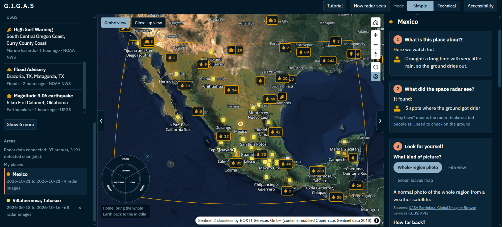
</p>
<p align="center">The program in Simple mode: live events on the left, Mexico on the globe with its markers, and "Your guide" on the right.</p>

## Features

### The globe

- **Globe and close-up views.** The close-up view is a low, tilted camera with the horizon in sight. Switching views keeps your zoom.

<p align="center">
  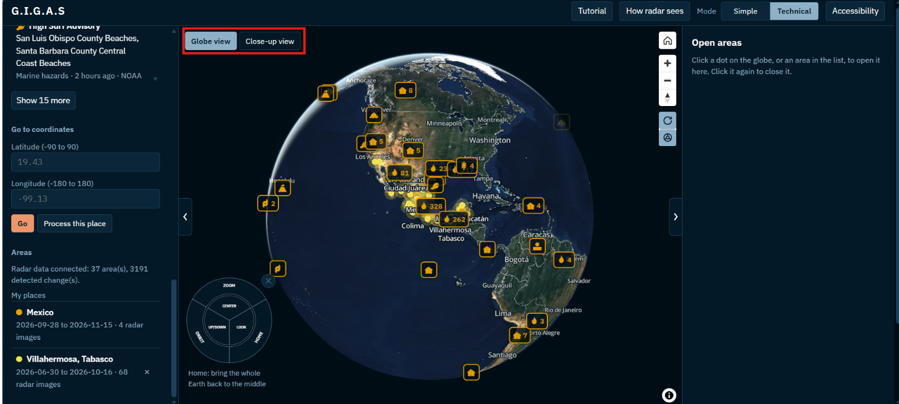
</p>
<p align="center">The Globe view and Close-up view buttons.</p>

- **Auto-rotate**, a **view wheel** (Zoom, Orbit, Look, Up/Down, Center, Home; works with mouse, touch and arrow keys) and a **home** button, as square buttons beside the zoom buttons.

<p align="center">
  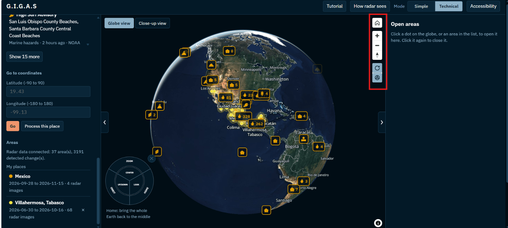
</p>
<p align="center">Home, zoom, compass, auto-rotate and view wheel buttons.</p>

<p align="center">
  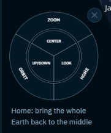
</p>
<p align="center">The view wheel.</p>

- **Three looks** for the Earth: High Quality (cloud-free Sentinel-2 mosaic, sharp down to city blocks), Hologram (dark outline map) and Street map.

<table>
  <tr>
    <td align="center" width="33%">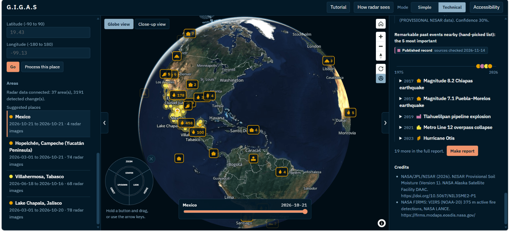<br>High Quality</td>
    <td align="center" width="33%">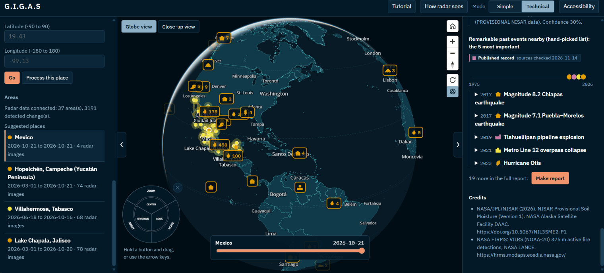<br>Hologram</td>
    <td align="center" width="33%">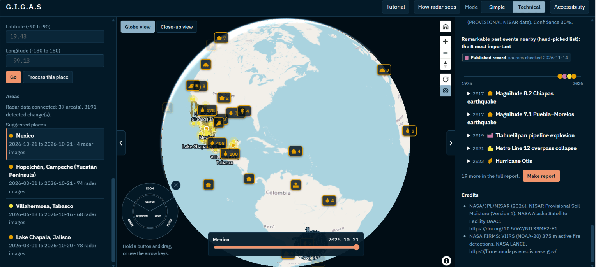<br>Street map</td>
  </tr>
</table>

<p align="center">
  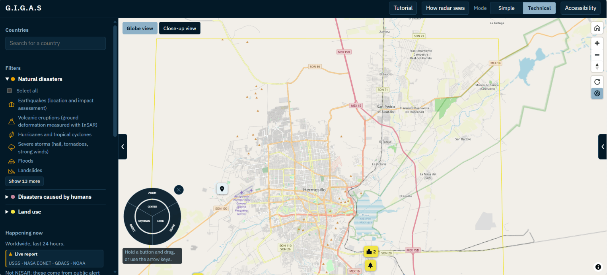
</p>
<p align="center">Street map, zoomed in on Hermosillo, Sonora.</p>
- **City names** in English, Spanish and German, largest cities first (Natural Earth populated places).
- **Grouped markers.** Events of the same type close together on screen share one square marker with its type icon and a count. Filled markers are radar detections; hollow markers are live events. Clicking a marker lists its events at the top of the right panel, and double-clicking zooms to the group. Markers stay clickable while the globe turns.
- **An orbiting satellite** as a decoration. Its orbit has NISAR's tilt, but its position, height and size are not real, and the tutorial says so.
- **Side panels** can be pushed off screen and pulled back with the arrows on the globe's edges.

### Scope reduction

- **Country search.** Pick one or more countries: they are outlined on the globe, and the area list, the detected changes and the live events keep only what lies inside them.

<p align="center">
  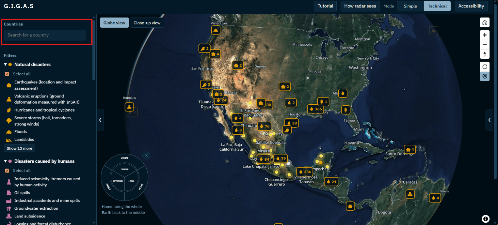
</p>
<p align="center">The country search, at the top of the left panel.</p>

- **Filters by type**, in three groups (natural disasters, disasters caused by humans, land use), each type with its own icon. Everything on the globe follows the filters.

<p align="center">
  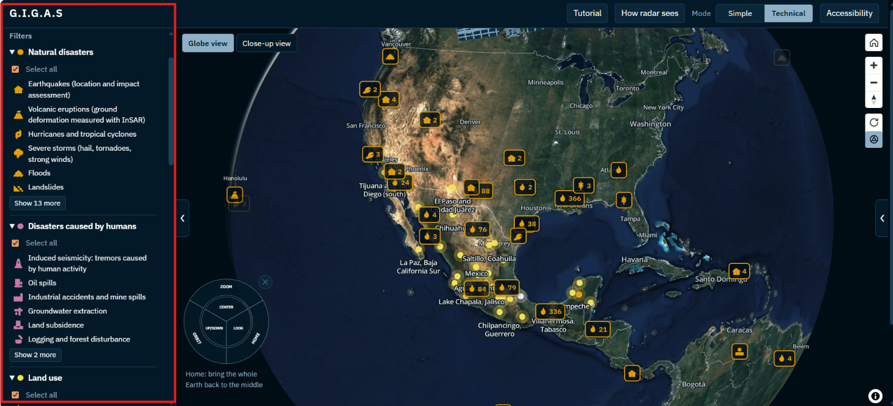
</p>
<p align="center">Filters by type, in three groups.</p>

- **My places.** Places you open are kept in your browser (only their coordinates) and listed for next time. New visitors see a few suggested places.
- **Go to coordinates** (Technical mode): fly to a latitude and longitude. **Process this place** asks the back end to analyze it. If the place is already a known area, that area opens instead.

<p align="center">
  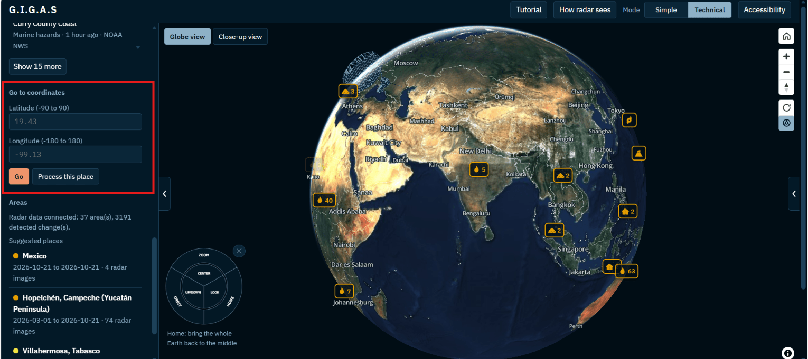
</p>
<p align="center">Go to coordinates (Technical mode).</p>

### Radar areas

Areas load only when needed: when you open one, or when you zoom in close over it. Clicking a marker or a list row opens the area as a tab:

- **Radar pictures** with a **date slider at the bottom of the globe** and an opacity control. In Technical mode you choose the layer (backscatter per polarization, detected change, ground motion, soil moisture); in Simple mode the app picks the most telling one.
- **A color key** for every picture and a plain description of what it shows.
- **"What the radar found here"**: a short summary of the changes found in the area, written by the back end for every area, including places looked up by visitors.
- **"Where this comes from"**: product, polarization, data maturity, source granules, processing steps, parameters, software and credit.
- **A source badge on every piece of data** (◆ NISAR radar, ● other satellite, ▲ live report, ■ published record), with the product and the date it was taken.
- **Change over time**: a line chart per unit with a hover readout and a table view.
- **Timeline** of radar passes and the five most important detected changes, with a confidence figure in Technical mode. The rest are in the report.
- **Before/after comparator**: drag a line across two pictures, for NISAR radar pictures and for optical satellite photos from NASA GIBS (Landsat/Sentinel-2 at 30 m, or daily VIIRS), from 1 month to 10 years apart. Ctrl/⌘ + scroll zooms. In Technical mode a slider highlights only changes larger than a chosen percentage (also given in dB).
- **PDF report** per area: press **Make report**, then read it inside the page or download it. A cover with key numbers, then numbered sections with pictures, charts and tables, every part labelled with its source and date, and a numbered list of references (mostly NASA).

#### A radar area, step by step (Villahermosa, Tabasco, in Technical mode)

<p align="center">
  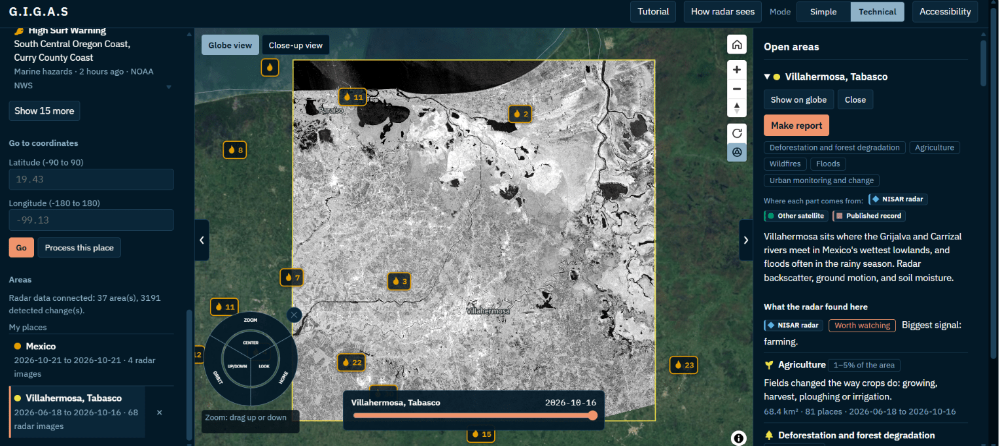
</p>
<p align="center">The area card: Make report, the types of change watched for, where each part comes from, and what the radar found.</p>

<p align="center">
  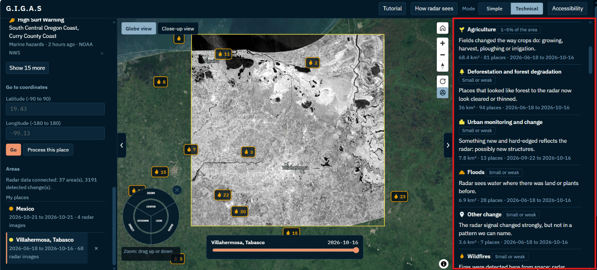
</p>
<p align="center">"What the radar found here": each type of change with its level, its area, how many places and when.</p>

<p align="center">
  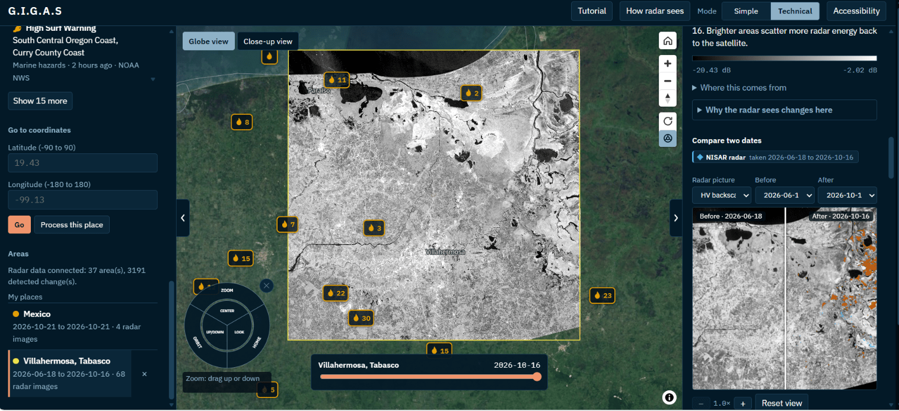
</p>
<p align="center">Comparing two NISAR radar dates (HV backscatter, June and October 2026).</p>

<p align="center">
  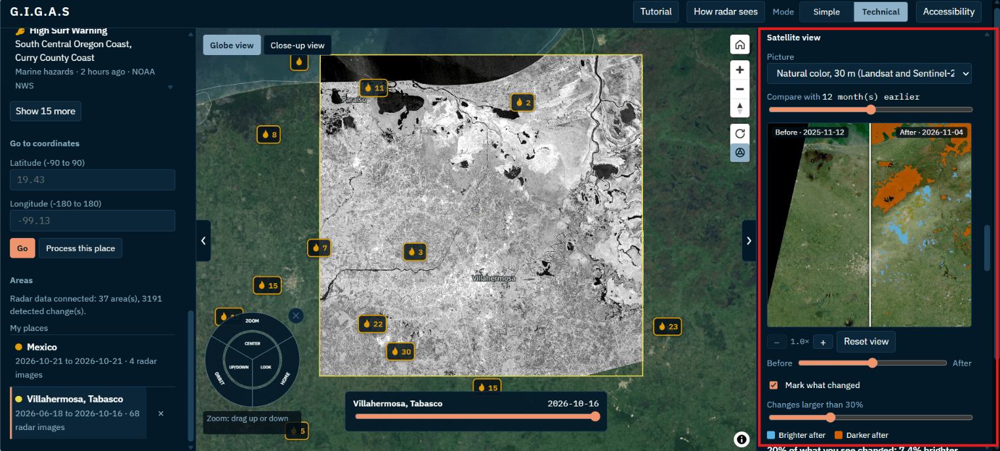
</p>
<p align="center">Optical satellite photos a year apart, with changes larger than 30% marked (blue: brighter, orange: darker).</p>

<p align="center">
  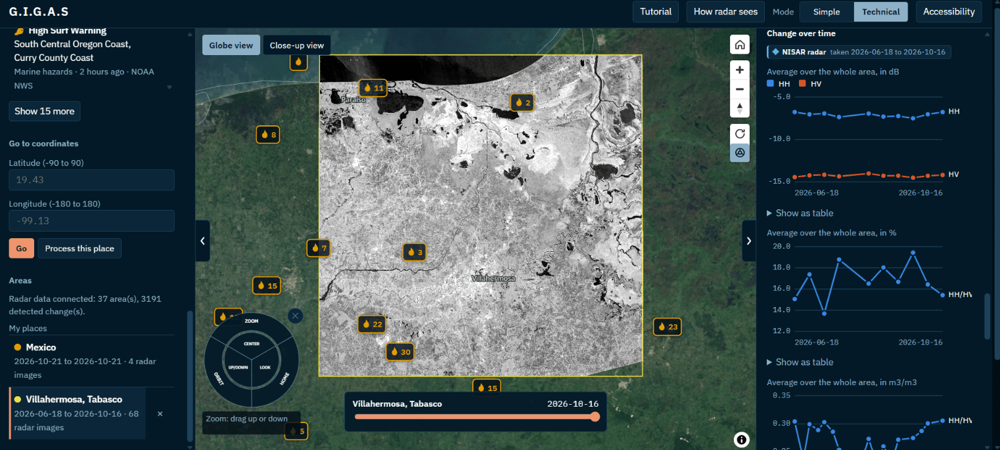
</p>
<p align="center">Change over time: the radar signal of the whole area, date by date.</p>

<p align="center">
  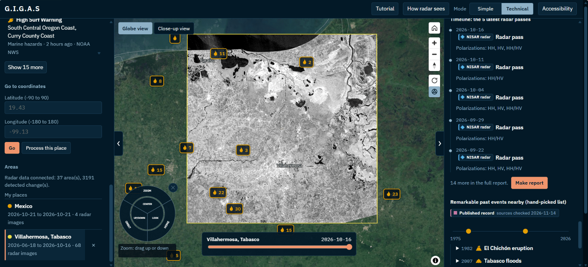
</p>
<p align="center">The timeline of radar passes, and remarkable past events nearby (a hand-picked list, labelled as such).</p>

#### Close-ups of the area card (Mexico, soil moisture)

<table>
  <tr>
    <td align="center" width="33%">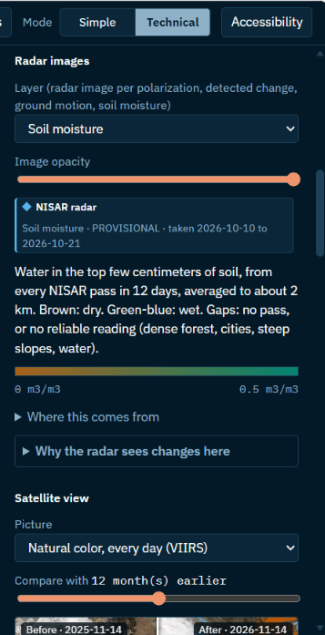<br>Layer picker, source badge and color key</td>
    <td align="center" width="33%">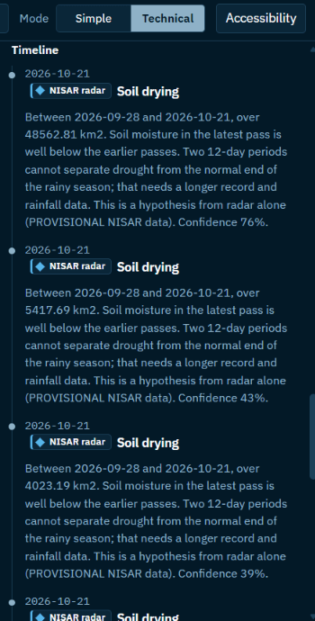<br>Detected changes, each with its confidence</td>
    <td align="center" width="33%">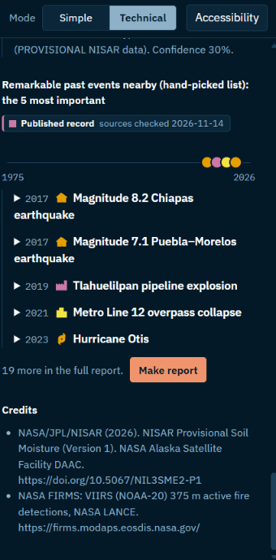<br>Hand-picked past events and credits</td>
  </tr>
</table>

### Simple mode: "Your guide"

Simple mode has its own side panel, written for beginners: a welcome guide, then six numbered questions for each place:

1. What is the place about?
2. What did the space radar see?
3. Look for yourself (pick the kind of picture and how far back)
4. Did you know?
5. Where does this come from?
6. Words to know

<table>
  <tr>
    <td align="center" width="33%">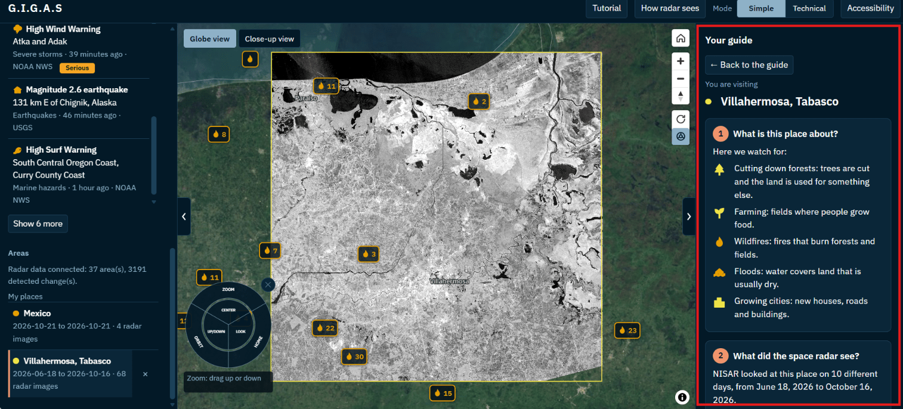<br>1-2: The place and what the radar saw</td>
    <td align="center" width="33%">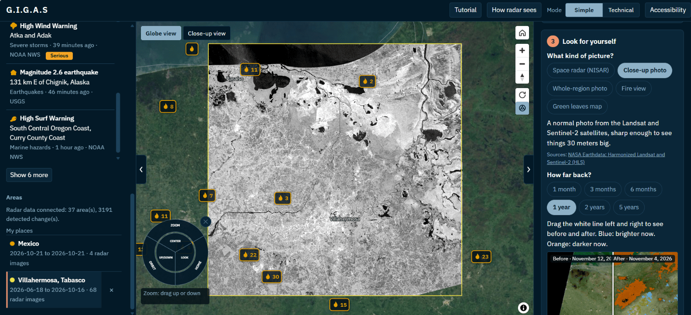<br>3-4: Look for yourself</td>
    <td align="center" width="33%">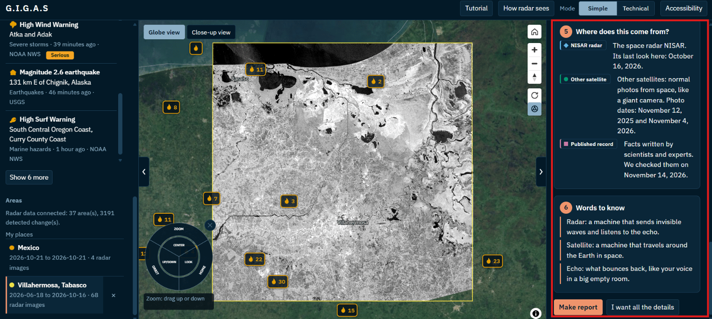<br>5-6: Sources and words to know</td>
  </tr>
</table>

A **"Why the radar sees changes"** section explains with pictures, in every area card, and can expand to a full page with the "How radar sees"
button tab.
<p align="center">
  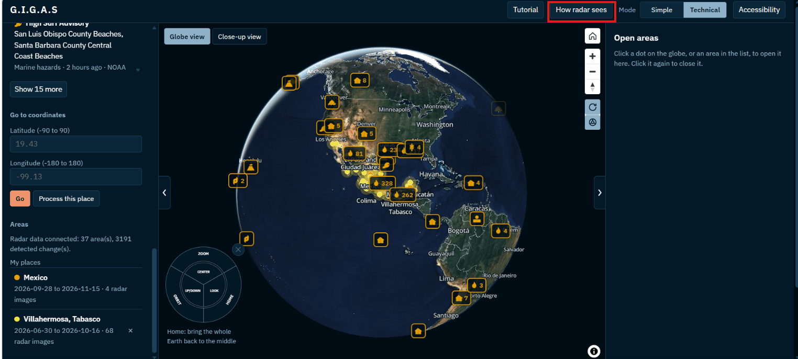
</p>
<p align="center">"How radar sees" button opens the explainer.</p>

### Live events ("Happening now")

- Hollow markers on the globe and a list that says **what, where, how long ago, and who reported it**. Serious and extreme events carry a danger label. Clicking a row flies there and opens the details with a link to the source.

<p align="center">
  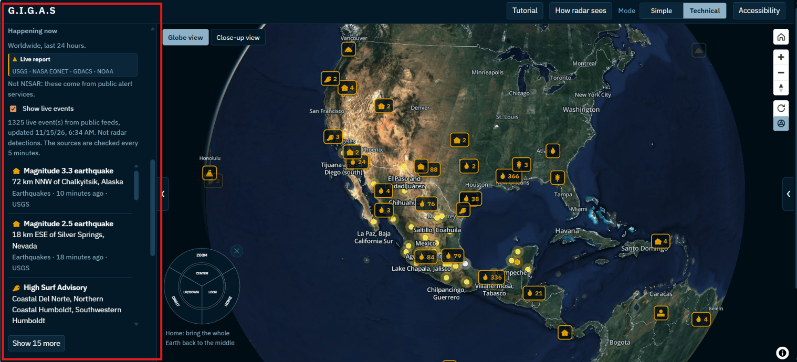
</p>
<p align="center">"Happening now": live events worldwide from the last 24 hours, labelled as not NISAR.</p>

<p align="center">
  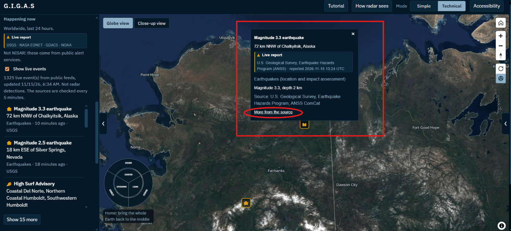
</p>
<p align="center">The details of a live event, with its source and a link to it.</p>

- The page asks the sources itself **every 15 minutes**, so it works wherever it is opened, even without the server. New events appear and expired ones leave without a reload. The server also keeps its own copy, refreshed every 5 minutes.
- See [the next section](#live-events-sources-and-update-times) for the sources.

### For everyone

- **Simple and Technical modes**, switched in the header with an animated cross-fade.

<p align="center">
  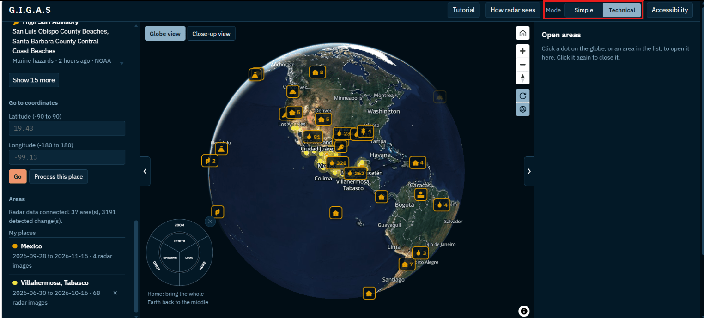
</p>
<p align="center">The mode switch in the header.</p>

- **Three languages**: English, Spanish and German.
- **Guided tutorial** on the first visit and from the Tutorial button.
- **Works on phones**, in portrait and landscape.
- **Accessibility**: full keyboard use, screen-reader labels, color never used alone (types are always named and have icons), a colorblind-safe palette for the filter groups and charts, and reduced motion respected throughout (animations become fades or stop).
- **Honesty notices**: a banner whenever example places or synthetic test data are on screen.

<p align="center">
  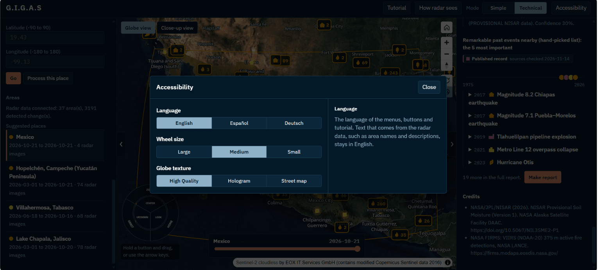
</p>
<p align="center">The accessibility menu: language, wheel size and globe look.</p>

## Live events: sources and update times

Only official sources are used, and every event names its source.

| Source | Types it feeds | Coverage |
|---|---|---|
| U.S. Geological Survey, Earthquake Hazards Program | Earthquakes (M2.5+); also landslides, collapses, ice quakes and human-caused shaking when its network records them | World |
| GDACS (United Nations OCHA and European Commission JRC) | Tropical cyclones, floods, volcanoes, drought, wildfires | World |
| NASA EONET (Earth Observatory Natural Event Tracker) | Wildfires, severe storms, volcanoes, sea ice, dust, heat and cold, and others | World |
| NOAA National Weather Service alerts | Storms, hurricanes, floods, heat, cold, dust, fire weather, marine hazards, and watches ("Forecast") | United States |
| U.S. Geological Survey, Volcano Hazards Program | Volcanoes at a raised alert level | United States |
| NOAA National Hurricane Center, NASA FIRMS fire detections (VIIRS on NOAA-20) | Tropical cyclones, fire hot spots | Only through the back end (see [Known limits](#known-limits)) |

**When an event leaves the globe:** a moment in time (an earthquake, a fire detection) after 24 hours; an event its source still lists as going on (a flood, a drought, a weather alert, a restless volcano) when the source stops listing it.

**No live source exists** for the slow changes (subsidence, groundwater extraction, logging, coastal land loss, permafrost, ice sheets). Those are exactly what the NISAR radar areas are for.

## The NISAR pipeline (back end)

<!-- Written from backend/README.md and docs/ on main. Back-end lane: please check this section. -->

The back end (`backend/`, Python) turns NISAR granules into the map layers and change events the globe shows. It uses three NISAR products, all NASA data:

| Product | What it measures | Used for |
|---|---|---|
| **GCOV** (L2, 10 m, HH and HV backscatter) | How bright the surface is to the radar | Surface type; floods, forest or vegetation loss, new structures, crops |
| **GUNW** (L2, 80 m, unwrapped interferograms) | Ground motion between two passes (cm) | Subsidence |
| **SME2** (L3, about 200 m) | Soil moisture | Soil drying (a drought signal) |

Steps, per site:

1. **Select** granules with `asf_search` (same viewing geometry, frames that cover the site, never mixing data maturities).
2. **Read** only the site's window over HTTPS, never whole 2-7 GB files.
3. **Detect** change signatures (for example: both polarizations darken to open-water levels; HV drops over vegetation; line-of-sight motion over 5 cm per year). Burn scars use NASA FIRMS fire detections from the fire season, with NISAR showing the ground afterwards.
4. **Classify** them into typed events with a confidence figure and a plain-language summary. Events under confidence 0.3 are not published.
5. **Export** the contract files the globe reads: an index of areas, and per area its layers, time series, events, history and a plain-language summary card. Events whose dates have left the series are kept as archived.

**Sites (Mexico):**

| Site | Watched for |
|---|---|
| Hopelchén, Campeche (Yucatán Peninsula) | Deforestation, farmland |
| Villahermosa, Tabasco | Floods |
| Lake Chapala, Jalisco | Wildfires, forest loss |
| Mexico (whole country) | Soil moisture mosaic, fires |
| 33 cities: Mexico City, Guadalajara, Monterrey, Puerto Vallarta, El Paso and Ciudad Juárez, Tijuana, and 27 state capitals | Sinking ground |

<p align="center">
  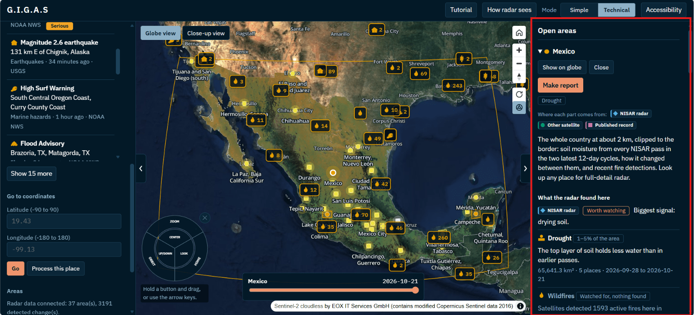
</p>
<p align="center">The country-wide area in Technical mode: soil moisture at about 2 km, drought and fire detections.</p>

The server re-checks every site for new NISAR passes every 12 hours, one site at a time. Visitors can also ask for any other place (**public lookup**): the point snaps to a 22 km grid cell, so nearby requests share the result, and a point within 10 km of a known site gets that site.

**Public API** (at `api.gigas.earth`): `GET /api/areas` (every processed area), `GET /api/events` (detected changes, filterable by area, type, dates and minimum confidence), `GET /api/live` (live events), plus history by point and dates. Details: `backend/README.md`.

**Which polarizations show the change:** HH responds most to surface roughness and to water (floods darken it); HV responds to volume scattering in vegetation, so a drop in HV larger than in HH points to canopy loss. The app lets you switch between them in Technical mode.

## Architecture

```
NISAR products (ASF DAAC, NASA Earthdata)        NASA FIRMS, NOAA NHC
        |  select + stream only the needed window      |
        v                                              v
backend/  (Python, Azure VM): select -> read -> detect -> classify -> export
        |  index, areas, layers, time series, events, live  (data contracts, docs/04-contracts.md)
        v
Azure Blob Storage (plain files)   +   API at api.gigas.earth (lookups, queries)
        |
        v
frontend/ (Vite + TypeScript + MapLibre GL JS, Cloudflare Worker at gigas.earth)
        ^   <---  public live feeds (USGS, GDACS, NASA EONET, NOAA NWS)
        |   <---  NASA GIBS (before/after pictures), Sentinel-2 cloudless tiles
        v
the browser: globe, panels, charts, PDF reports
```

- The two halves meet **only at the data contracts**, so each can be built and tested alone.
- **Static first:** the app runs from plain files. The server is needed only to process a new place on request, answer API queries and refresh the data. The site is hosted apart from the server, so it stays up even if the server is down.
- **Provenance everywhere:** every layer carries its granules, product, maturity and parameters.

## How to run it

**Front end** (needs Node.js):

```
cd frontend
npm ci
npm run dev       # http://localhost:5173
npm test          # unit tests
npm run build     # type-check + static build into dist/
```

Without a back end the app still runs: it shows example places (labelled as examples) and live events. To see the real radar areas, point it at the team's public storage:

```
VITE_DATA_BASE=https://gigassars.blob.core.windows.net/data/ npm run dev
```

**Back end** (needs [uv](https://docs.astral.sh/uv/) and a NASA Earthdata token in `backend/.env`):

```
cd backend
uv run sars-pipeline run            # select and process every site
uv run sars-pipeline serve          # API on http://127.0.0.1:8765/
```

Details: `frontend/README.md`, `backend/README.md`, and `backend/deploy/README.md` for the Azure and Cloudflare setup.

## NASA data and other sources

**NASA data**

- **NISAR** GCOV, GUNW and SME2 products (NASA/JPL-Caltech and ISRO, distributed by the Alaska Satellite Facility DAAC). The exact granules behind every layer are listed in its provenance.
- **NASA GIBS** (Global Imagery Browse Services): before/after optical pictures.
- **NASA EONET**: live natural events.
- **NASA FIRMS**: fire detections (VIIRS on NOAA-20), for live fires and burn scars.

**Other sources**, each credited in the app:

- USGS (earthquakes, volcano alert levels), NOAA (weather alerts, hurricanes), GDACS (United Nations and European Commission).
- Globe imagery: Sentinel-2 cloudless by EOX IT Services GmbH (contains modified Copernicus Sentinel data 2016), CC BY 4.0.
- Street map: © OpenStreetMap contributors (ODbL). Outline map: MapLibre demo tiles.
- Country outlines and city names: Natural Earth (public domain).
- Typefaces: IBM Plex Sans and IBM Plex Mono (SIL Open Font License 1.1).
- PDF reports: made with jsPDF (MIT) and shown with pdf.js (Mozilla, Apache 2.0).
- NISAR illustration in this README: "NISAR in Orbit (Artist's Concept)", PIA26613, NASA/JPL-Caltech.
- Satellite model: generated by the team with Meshy from the same NASA/JPL-Caltech illustration (PIA26613).

The full list with DOIs and licenses is in `docs/09-references.md`. Why each data source and method was chosen, and what was given up, is in `frontend/DECISIONS.md`.

## What is real and what is not

The project's rule is that nothing synthetic is ever shown as real.

- **Example places** appear only while no radar data is connected, and are labelled as examples.
- **Synthetic test data** carries a banner and a tag on every area that uses it.
- **Live events** are labelled "not radar detections" and each names its source.
- **Hand-written text** (background notes on a place, the list of past disasters) is labelled as such, and shown only for the place it was written for.
- **The orbiting satellite** is an illustration, and the tutorial says so.
- **Detections are not validated on the ground.** Each carries a confidence figure. The 0.3 confidence floor and the alert levels in the summary cards are judgment calls, documented in `backend/README.md` with the detection rules.

## Known limits

- **Two live sources need the back end:** NOAA's hurricane center does not accept requests from web pages, and NASA FIRMS needs a key. Tropical cyclones still arrive through GDACS.
- **Weather alerts and volcano alert levels cover the United States only.**
- **NISAR data gap:** there is no usable data for the sites between 2026-01-20 and 2026-06-16 (Mexico's dry and fire season), and older data is not mixed with newer data of a different maturity. Fires in that season are located with FIRMS, and the radar shows the ground after.
- **The newest radar dates** (late October on) are published as VALIDATED and are not shown yet, because a series never mixes maturities and VALIDATED has only one or two dates per frame so far.
- **"What the radar found here"** is in English only; the names of the types of change are translated.
- **Markers** of different types can overlap, and a looked-up place with no NISAR data stays "Processing" until you remove it.
- **Country filter:** outlines are coarse (1:110m), so a point just off the coast counts as outside, and the smallest countries are missing.
- **Translations** (Spanish, German) are machine-written and not yet checked by native speakers.
- **Not yet checked:** browsers other than Chrome, a screen reader, keyboard use of the markers.
- **Public tile servers** (OpenStreetMap, EOX) are for light use; a hosted tile service is needed before real traffic.

## Future

- More radar areas beyond Mexico, and ground-motion figures for dams, levees and sinking cities.
- A date and confidence filter for detected changes in the app (the API already has one).
- Live sources for more regions (weather alerts outside the United States).
- Translated summary cards, native-speaker review of the translations, and more languages.

## File descriptions

| Path | What it holds |
|---|---|
| `frontend/` | The web app |
| `frontend/src/main.ts` | The page: panels, filters, areas, live events, welcome screen |
| `frontend/src/globe.ts` | The MapLibre globe, its layers, markers and camera |
| `frontend/src/livefeeds.ts` | Live events fetched from the public sources |
| `frontend/src/places.ts` | My places, kept in the browser |
| `frontend/src/compare.ts`, `compare-core.ts`, `satview.ts` | Before/after comparator; satellite pictures from NASA GIBS |
| `frontend/src/report.ts`, `report-core.ts`, `reader.ts`, `pdf-text.ts` | PDF report per area and the reader inside the page |
| `frontend/src/kid.ts` | Simple mode's guide ("Your guide") |
| `frontend/src/explain.ts`, `explain-view.ts` | "Why the radar sees changes" explainer |
| `frontend/src/origin.ts`, `sources.ts` | Source badges and the cited sources |
| `frontend/src/decisions.ts` | Methods and decisions (also written to `DECISIONS.md`) |
| `frontend/src/satellite.ts` | The orbiting satellite (WebGL custom layer) |
| `frontend/src/filters.ts`, `icons.ts`, `legend.ts` | Types of change, their groups, colors, icons and color keys |
| `frontend/src/i18n.ts` | Every interface text in English, Spanish and German |
| `frontend/src/chart.ts`, `wheel.ts`, `tour.ts`, `settings.ts` | Chart, view wheel, tutorial, accessibility menu |
| `frontend/src/assets/` | Country outlines, city names, satellite model |
| `frontend/src/logic.ts`, `frontend/test/` | Pure logic and its unit tests |
| `frontend/DECISIONS.md` | Why these data and methods were chosen |
| `backend/` | The NISAR pipeline, the live feeds and the data server |
| `backend/sites.json` | The curated sites |
| `backend/deploy/` | Azure server and Cloudflare site setup |
| `docs/` | Challenge text, product spec, architecture, data contracts, references, status log |
| `specs/` | Feature specs with acceptance criteria |

## Languages, frameworks and other technologies

- **Front end:** TypeScript, Vite, MapLibre GL JS (globe projection), WebGL, jsPDF (makes the reports), pdf.js (shows them), plain DOM and CSS (no UI framework), Node's built-in test runner.
- **Back end:** Python, uv, `asf_search`, `h5py` + `fsspec`, pytest, ruff.
- **Hosting:** Cloudflare Workers (the site, gigas.earth); Microsoft Azure virtual machine and Blob Storage (the API and the data), Docker Compose, Caddy.
- **Data services:** NASA Earthdata / ASF DAAC, NASA GIBS, NASA EONET, NASA FIRMS, USGS, NOAA, GDACS.

## Use of AI

Two AI tools were used. **Claude** (Anthropic) wrote code under the team's direction and review, and wrote the Spanish and German interface texts. **Meshy** generated the satellite 3D model from NASA/JPL-Caltech's illustration of NISAR. No AI-generated images, audio or video are shown as data, and no data is invented: see [What is real and what is not](#what-is-real-and-what-is-not).

## License

<!-- TODO (team): add a LICENSE file. Space Apps requires an open-source (OSI) licence; Apache 2.0 applies if none is given. -->

## Team members and their contributions

| Name | Role |
|---|---|
| Diego de Silva Hernandez | Front-end development |
| Adrián Madrid Castro | Front-end development |
| Hector Lerma Scott | Back-end development |
| Jose Pablo Mendez Espino | Back-end development |
| Samuel André Rivera Dominguez | Documentation |

<!-- TODO (team): GitHub profile links, and a team photo if you want one. -->
