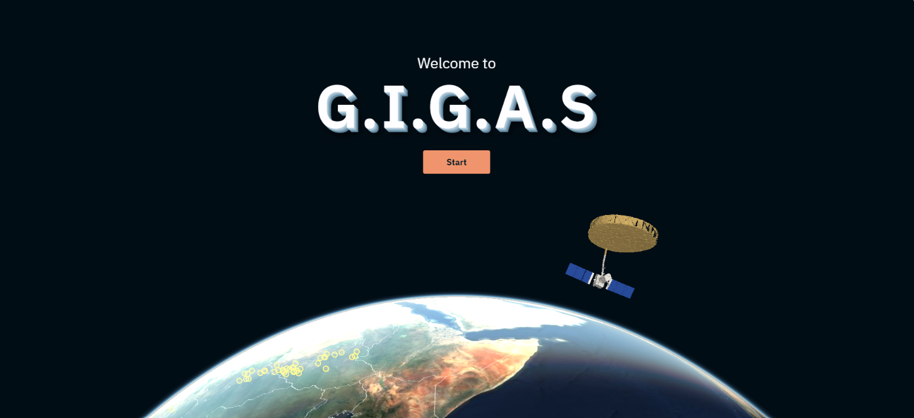

# G.I.G.A.S: Global Interactive Geographical Analytics System

<p align="center">
  
</p>

**Team:** [Borrenautas](https://www.spaceappschallenge.org/2026/find-a-team/borrenautas/?tab=members) · **Challenge:** [Dancing with the SARs](https://www.spaceappschallenge.org/2026/challenges/dancing-with-the-sars/), NASA International Space Apps Challenge 2026 · **Branch:** `jopa-testing`

G.I.G.A.S is an open-source web app that shows how the Earth's surface changes, as seen by the NISAR radar satellite, on an interactive 3D globe. A back end turns NISAR radar products into map layers and typed change events (floods, forest loss, sinking ground, soil drying). The globe shows them next to live disaster reports from official public sources. Every piece of information says where it comes from and when, in plain words for the public and with full technical detail for scientists.

> **About this branch.** `jopa-testing` is a teammate's working branch. It holds the team's latest `main` and `frontend` (merged on 2026-11-15) plus the work described in [What this branch adds](#what-this-branch-adds). `main` is the team's ground truth and is not changed from here. The change history is in [CHANGELOG.md](CHANGELOG.md) and, round by round, in [frontend/JOPA_TESTING.md](frontend/JOPA_TESTING.md).

## Contents

1. [About the project](#about-the-project)
2. [Background](#background)
3. [Who it is for](#who-it-is-for)
4. [Live site and demo](#live-site-and-demo)
5. [What this branch adds](#what-this-branch-adds)
6. [The web application](#the-web-application)
7. [Features](#features)
8. [Area reports (PDF)](#area-reports-pdf)
9. [Live events: sources and update times](#live-events-sources-and-update-times)
10. [The NISAR pipeline (back end)](#the-nisar-pipeline-back-end)
11. [Architecture](#architecture)
12. [Quick start](#quick-start)
13. [Repository layout](#repository-layout)
14. [Documentation](#documentation)
15. [NASA data and other sources](#nasa-data-and-other-sources)
16. [What is real and what is not](#what-is-real-and-what-is-not)
17. [Known limits](#known-limits)
18. [Future](#future)
19. [Languages, frameworks and other technologies](#languages-frameworks-and-other-technologies)
20. [Use of AI](#use-of-ai)
21. [Contributing](#contributing)
22. [License](#license)
23. [Team](#team)

## About the project

Submission for the challenge [Dancing with the SARs](https://www.spaceappschallenge.org/2026/challenges/dancing-with-the-sars/) (event: November 14-15, 2026).

The Earth's surface is always changing: wetlands flood and dry, forests are cleared or burn, cities sink as groundwater is pumped out, fields change with the seasons. Radar satellites see these changes day and night and through clouds, but radar images are hard to read without training.

G.I.G.A.S makes that data readable:

- A **3D globe** you can spin, zoom and search by country or coordinates.
- **Radar areas**: places processed from NISAR data, each with its radar pictures over time, the changes detected, charts, and where every image comes from.
- **Live events**: what is happening on Earth right now (earthquakes, fires, floods, storms, volcanoes and more), from official sources, always labelled as *not* radar detections.
- **Two modes**: *Simple*, a guide written so a 10-year-old can follow it, and *Technical*, with every layer, measurement and provenance record.
- **A PDF report per area**, kept up to date as new data arrives, with every explanation cited.

The hackathon demo covers Mexico (a country-wide soil-moisture view and three case studies); the design is global.

## Background

NISAR (NASA-ISRO Synthetic Aperture Radar) is a radar satellite from NASA and ISRO, launched on July 30, 2025. It sends its own microwave pulses (L-band, 24 cm) and records how much energy comes back, so it works by day and by night and through clouds, and it observes the world's land and ice every 12 days ([NASA](https://science.nasa.gov/mission/nisar/mission-overview/)). Calm water reflects the pulse away and looks black; rough surfaces look brighter, and even brighter when wet; buildings act as corner reflectors and show up as bright spots ([NASA Earthdata](https://www.earthdata.nasa.gov/learn/earth-observation-data-basics/sar/image-interpretation)). Comparing the phase of two passes measures ground motion up to the centimeter level ([NASA Earthdata](https://www.earthdata.nasa.gov/learn/earth-observation-data-basics/sar)).

The challenge asks for an interactive application that uses NISAR data to track and visualize one or more types of surface change, with intuitive tools that make the data understandable to a broad audience ([docs/00-challenge.md](docs/00-challenge.md)).

## Who it is for

| User | What they get |
|---|---|
| Public, children and educators | Simple mode: a step-by-step guide in everyday words, pictures to compare, true facts with their sources, three languages, a guided tutorial |
| Resource managers and decision-makers | Where and when change happened, how big, how confident the detection is, what is happening live nearby, and a PDF report to share |
| Scientists | Technical mode: every layer and polarization, value ranges, time series, before/after comparison in dB, and full provenance (granules, product, maturity, parameters) |

## Live site and demo

- **Live site** (the team's build of `main`/`frontend`, on a Cloudflare Worker): https://gigas-project.starl0stgaming.workers.dev. It does not include this branch's additions until the team merges them.
- **Demo video:** awaiting video.
- **Run this branch yourself:** see [Quick start](#quick-start).

## What this branch adds

On top of the team's app (everything in [Features](#features) not marked "this branch" is team work, kept as it is):

| Addition | In short |
|---|---|
| **Where every piece of data comes from** | One badge style everywhere, shape + name + color: ◆ NISAR radar, ● other satellite, ▲ live report, ■ published record, each with the product and the date it was taken |
| **"Why the radar sees changes"** | Seven short illustrated ideas (an echo not a photo, calm water, corners, leaves, wet ground, centimeters, what can fool it), each sentence backed by a cited NASA page |
| **Before/after comparator** | For NISAR radar pictures (any two dates, measured in dB) and satellite photos: divider, zoom 1-8×, drag, and a "changes larger than N%" control that marks what got brighter or darker and says how much of the view changed; clouds are left out |
| **Simple mode guide** | A side panel written for a 10-year-old: what the place is about, what the space radar found, pictures to compare (kind of picture and how far back), a true fact, where it all comes from, words to know |
| **Shorter Technical cards** | Timelines keep the 5 most important detected changes and remarkable events; everything else is in the report |
| **Area reports (PDF)** | A structured report per area, made in the browser from a fixed template, remade as a new version whenever new data changes it, with numbered citations and a References section; readable inside the page in any browser |
| **Mexico context** | Notes per study zone on what changed, including plants and animals, and remarkable events in each zone, every item with its sources |
| **Sources policy** | No sentence states a fact without a source that was opened and read ([docs/13-sources-policy.md](docs/13-sources-policy.md)) |
| **Robust loading** | Failed or slow loads keep the last good data and say so; reports are never made from incomplete data |
| **Decision log** | Why these data and methods, and what was given up: [frontend/DECISIONS.md](frontend/DECISIONS.md) (in the repository, not shown in the app) |

## The web application

The app opens on a welcome screen: the name over the Earth's horizon, slowly turning. Pressing **Start** sends the letters round the Earth while the camera pulls back to the whole globe and the panels slide in. The house button brings you back.

The screen has three parts:

- **Left panel**: country search, filters by type of change, live events ("Happening now"), coordinates (Technical mode) and the list of radar areas.
- **The globe**: one map that is a globe when zoomed out and a flat map when zoomed in.
- **Right panel**: in Technical mode, the areas you opened, stacked as tabs; in Simple mode, the guide.

<p align="center">
  
</p>
<p align="center">The globe with live events over North and Central America.</p>

The screenshots in this README were taken on the team's `frontend` branch on 2026-11-14. On this branch the area cards also carry the source badges, the comparators, the explainer and the report controls described below.

## Features

### The globe

- **Globe and close-up views.** The close-up view is a low, tilted camera with the horizon in sight. Switching views keeps your zoom.
- **Auto-rotate**, a **view wheel** (Zoom, Orbit, Look, Up/Down, Center, Home; mouse, touch and arrow keys) and a **home** button.

<p align="center">
  
</p>

- **Three looks** for the Earth: High Quality (cloud-free Sentinel-2 mosaic), Hologram (dark outline map) and Street map.
- **An orbiting satellite** as a decoration, modelled on NASA/JPL-Caltech's NISAR illustration. Its orbit has NISAR's tilt, but its position, height and size are not real, and the tutorial says so.
- **Phone layout**: the globe on top and the panels below, with Explore / Open areas tabs.

### Finding things

- **Country search.** Pick one or more countries: they are outlined on the globe, and the area list, the detected changes and the live events keep only what lies inside them.

<p align="center">
  
</p>

- **Filters by type**, in three groups (natural disasters, disasters caused by humans, land use), each type with its own icon, filled when on and outlined when off, with "Show N more" per group.
- **Go to coordinates** (Technical mode): fly to a latitude and longitude. **Process** asks the back end to analyze that place.

### Radar areas, Technical mode

Clicking a dot or a list row opens the area as a tab:

- **A key of the sources** the card uses (this branch), then the area's summary.
- **Radar pictures** with a date slider at the bottom of the globe and an opacity control: backscatter per polarization, detected change, surface type, ground motion, soil moisture. Each picture carries its badge, for example *NISAR radar · GCOV HV · PROVISIONAL · taken 2026-08-14* (this branch).
- **"Why the radar sees changes here"** (this branch): the ideas behind this area's kind of change, folded until opened.
- **Compare two dates** (this branch): any two NISAR passes of HH or HV, with zoom and a change threshold in % and dB; a warning appears if the two dates have different data maturity.
- **Satellite view** (NASA GIBS): before and now from 1 month to 10 years apart, in the same comparator (this branch), with sharper pictures when zoomed in.
- **Change over time**: a line chart per unit with a table view.
- **What changed in the zone**, including plants and animals, with sources (this branch).
- **Timeline**: the 5 most important detected changes (largest and surest), and **remarkable events** in the zone, the 5 most important (this branch); the full lists are in the report.
- **Area report** (this branch): *Read the report* and *Download full report (PDF)*, with the report's version and when it was made.

<p align="center">
  
</p>
<p align="center">Technical mode (team build): Lake Chapala, Jalisco, with the HH radar picture, its color key and where it comes from.</p>

<p align="center">
  
</p>
<p align="center">Change over time: the radar signal of the whole area, date by date.</p>

### Simple mode: the guide (this branch)

The right panel becomes **Your guide**, written so a 10-year-old can follow it. With no place open it explains how to use the map, what the dot colors mean and who NISAR is. With a place open it answers six numbered questions:

1. **What is this place about?** Each kind of change in one everyday sentence.
2. **What did the space radar see?** How many days NISAR looked and what it found, in words ("239 farm fields that changed").
3. **Look for yourself.** Pick the kind of picture (space radar, close-up photo, whole-region photo, fire view, green leaves map) and how far back (1 month to 5 years), then slide between before and after.
4. **Did you know?** One true fact, with its source.
5. **Where does this come from?** NISAR, other satellites and experts' reports, each with its date written out.
6. **Words to know.**

Then *Read everything* (the area report) and *I want all the details* (Technical mode).

### Live events ("Happening now")

- Rings on the globe and a list that says **what, where, how long ago, and who reported it**, worldwide, last 24 hours; serious and extreme events carry a tag. Clicking a row flies there and opens the details with a link to the source and the exact report time in UTC.
- The page reads the back end's live file every 5 minutes and asks the sources itself at most every 15 minutes, so it works wherever it is opened. New events appear and expired ones leave without a reload.

### For everyone

- **Simple and Technical modes**, switched in the header.
- **Three languages**: English, Spanish and German.
- **Guided tutorial** and **How radar sees** (this branch) in the header.
- **Accessibility**: full keyboard use, screen-reader labels, color never used alone (types are named and have icons; source badges have shapes), a colorblind-safe palette, and reduced motion respected throughout.
- **Honesty notices**: a banner whenever example places or synthetic test data are on screen, and a status line while data loads or when it could not be refreshed.

<p align="center">
  
</p>

## Area reports (PDF)

Each area has a report, made in the browser from a fixed template filled with the area's data. No AI runs when a report is made, and nothing in it is generated on the fly. Details: [docs/12-pdf-reports.md](docs/12-pdf-reports.md).

- **Cover:** the area, its key numbers (radar dates, detected changes, main kinds of change, data maturity), when each source last published, and clickable contents.
- **Sections:** 1 Where the data come from · 2 Pictures (radar first vs latest, change, surface type and ground motion maps, satellite before/now) · 3 Detected changes (by kind, by month, the 5 most important in full, then all) · 4 Change over time · 5 What changed in the zone · 6 Remarkable events · 7 Live reports nearby · 8 How the radar sees these changes · 9 Methods and decisions · 10 List of radar pictures · 11 Glossary · 12 References and data citations.
- **Always current:** a report is made when its area is shown and remade as a new version whenever new data changes what it shows (new radar results, detected changes, live reports nearby, a newer satellite photo, a language change). The cover of each new version lists what is new; the old file is thrown away.
- **Sourced:** every explanation carries numbered citations [n], listed with their links at the end (mostly NASA pages). The area's numbers, maps and tables come straight from the data files.
- **Readable anywhere:** *Read the report* opens it inside the page (drawn with pdf.js, page by page as you scroll), so it works even in browsers that block new tabs or have no PDF viewer; *Download* saves the file.

## Live events: sources and update times

Only official sources are used, and every event names its source.

| Source | Types it feeds | Coverage |
|---|---|---|
| U.S. Geological Survey, Earthquake Hazards Program | Earthquakes (M2.5+); also landslides, collapses and human-caused shaking when its network records them | World |
| GDACS (United Nations OCHA and European Commission JRC) | Tropical cyclones, floods, volcanoes, drought, wildfires | World |
| NASA EONET (Earth Observatory Natural Event Tracker) | Wildfires, severe storms, volcanoes, sea ice, dust, heat and cold, and others | World |
| NOAA National Weather Service alerts | Storms, hurricanes, floods, heat, cold, dust, fire weather, marine hazards, and watches | United States |
| U.S. Geological Survey, Volcano Hazards Program | Volcanoes at a raised alert level | United States |
| NOAA National Hurricane Center, NASA FIRMS fire detections | Tropical cyclones, fire hot spots | Only through the back end (see [Known limits](#known-limits)) |

**When an event leaves the globe:** a moment in time (an earthquake, a fire detection) after 24 hours; an event its source still lists as going on (a flood, a weather alert, a restless volcano) when the source stops listing it. If one source stops answering, its last events stay until they are 24 hours old, so one failing feed does not look like its events all ended.

**No live source exists** for the slow changes (subsidence, groundwater extraction, logging, coastal land loss). Those are exactly what the NISAR radar areas are for.

## The NISAR pipeline (back end)

The back end (`backend/`, Python) turns NISAR granules into the map layers and change events the globe shows. Full rules: [backend/README.md](backend/README.md).

| Product | What it measures | Used for |
|---|---|---|
| **GCOV** (L2, HH and HV backscatter) | How bright the surface is to the radar | Surface type; floods, forest or vegetation loss, new structures, crops |
| **GUNW** (L2, unwrapped interferograms) | Ground motion between two passes (cm, line of sight) | Subsidence |
| **SME2** (L3) | Soil moisture | Soil drying |

Steps, per site:

1. **Select** granules with `asf_search` (same viewing geometry, never mixing data maturities).
2. **Read** only the site's window over HTTPS, never whole multi-GB files.
3. **Detect** change signatures, for example: both polarizations drop 3 dB or more and HH ends at open-water levels (flood); HV drops 3 dB or more and 1.5 dB more than HH over vegetation (forest loss); HH rises 4 dB or more (new structures); line-of-sight sinking of 5 cm a year or more.
4. **Classify** them into typed events with a confidence figure and a plain-language summary; events under a confidence of 0.3 are not published.
5. **Export** the contract files the globe reads: manifest, layers, time series, events, history, live events.

Demo data (Mexico): a country-wide soil-moisture view and three case studies: Hopelchén, Yucatán Peninsula (forest loss and farmland), Villahermosa (floods) and Lake Chapala (wildfires). Visitors can ask the server to process any other place.

## Architecture

```
NISAR products (ASF DAAC, NASA Earthdata)
        |  select + stream only the needed window
        v
backend/ (Python): select -> read -> detect -> classify -> export
        |  manifest, layers, time series, events, history, live  (data contracts, docs/04-contracts.md)
        v
Azure: VM (API, refresh timers, push)  --copy-->  Blob Storage (public read)
                                                        |
frontend/ (Vite + TypeScript + MapLibre GL JS)  <-------+
        ^   <---  public live feeds (USGS, GDACS, NASA EONET, NOAA NWS)
        |   <---  NASA GIBS (satellite photos), Sentinel-2 cloudless tiles
        |   ----  jsPDF / pdf.js (reports, made and read in the browser)
        v
the browser (site on a Cloudflare Worker): globe, panels, charts, reports
```

- The two halves meet **only at the data contracts**, so each can be built and tested alone.
- **Static first:** the site runs from plain files; if the server stops, storage keeps serving every map, event and history. Only processing a new place and live push need the server.
- **Provenance everywhere:** every layer carries its granules, product, maturity and parameters, and every piece of data on screen says where it comes from.

More: [docs/02-architecture.md](docs/02-architecture.md), [backend/deploy/README.md](backend/deploy/README.md).

## Quick start

**Front end** (Node.js 22.18 or newer; the tests run TypeScript directly):

```bash
cd frontend
npm ci
npm run dev        # http://localhost:5173 (example places, live events)
npm test           # unit tests
npm run build      # type-check + static build into dist/
```

To see real NISAR results, point it at the team's storage and server:

```bash
cd frontend
VITE_DATA_BASE=https://gigassars.blob.core.windows.net/data/ VITE_API_BASE=https://gigas-sars.westus2.cloudapp.azure.com/ npm run dev
```

Without those variables the app looks for a local back end at http://127.0.0.1:8765/ and, without one, shows example places (labelled as examples) and live events.

**Back end** ([uv](https://docs.astral.sh/uv/), Python 3.12, and a NASA Earthdata token in `backend/.env`):

```bash
cd backend
uv run sars-pipeline run       # select and process every site
uv run sars-pipeline serve     # API on http://127.0.0.1:8765/
uv run pytest                  # tests
```

Regenerate the decision log after editing `frontend/src/decisions.ts`:

```bash
cd frontend && npm run decisions
```

## Repository layout

| Path | What it holds |
|---|---|
| `README.md` | This file |
| `CONTRIBUTING.md` | Branches, lanes, commit rules, checks before a push |
| `CHANGELOG.md` | What changed and when |
| `docs/` | Challenge, product spec, architecture, data sources, contracts, references, status log, user guide, reports, sources policy ([index](docs/README.md)) |
| `specs/` | Feature specs F00-F07 with acceptance criteria |
| `images/` | Screenshots used in this README |
| `frontend/` | The web app ([frontend/README.md](frontend/README.md)) |
| `frontend/src/main.ts` | The page: panels, filters, areas, cards, Simple-mode guide, live events, report controls |
| `frontend/src/globe.ts`, `satellite.ts` | The MapLibre globe, its layers and camera; the orbiting satellite |
| `frontend/src/livefeeds.ts` | Live events fetched from the public sources |
| `frontend/src/satview.ts` | Satellite photos from NASA GIBS (clear-day search) |
| `frontend/src/compare.ts`, `compare-core.ts` | The before/after comparator and its change arithmetic |
| `frontend/src/report.ts`, `report-core.ts`, `reader.ts`, `pdf-text.ts`, `legend.ts` | The report template, its versions, the in-page reader |
| `frontend/src/origin.ts` | Source badges |
| `frontend/src/explain.ts`, `explain-view.ts` | "Why the radar sees changes" |
| `frontend/src/sources.ts` | Every outside source the app's explanations cite |
| `frontend/src/decisions.ts`, `frontend/DECISIONS.md`, `frontend/scripts/` | The decision log and its generated document |
| `frontend/src/kid.ts` | Words for the Simple-mode guide |
| `frontend/src/mexico.ts` | Mexico zone notes and remarkable events, with sources |
| `frontend/src/filters.ts`, `icons.ts`, `i18n.ts` | Types of change, icons, every interface text (English, Spanish, German) |
| `frontend/src/chart.ts`, `wheel.ts`, `tour.ts`, `settings.ts` | Chart, view wheel, tutorial, accessibility menu |
| `frontend/src/logic.ts`, `frontend/test/` | Pure logic and its unit tests |
| `frontend/wrangler.jsonc` | The Cloudflare Worker that serves the built site |
| `frontend/JOPA_TESTING.md` | Round-by-round log of this branch |
| `backend/` | The NISAR pipeline and the data server ([backend/README.md](backend/README.md)) |
| `backend/deploy/` | Azure deployment: Docker, Caddy, scripts ([README](backend/deploy/README.md)) |
| `backend/sites.json` | The study areas |
| `data/` | Working data (granule selections are committed; processed output is not) |
| `.github/` | Issue and pull request templates, a test workflow |

## Documentation

All documents are listed in [docs/README.md](docs/README.md). The most useful:

- [User guide](docs/11-user-guide.md): how to use the app, mode by mode.
- [Area reports](docs/12-pdf-reports.md): the template, versions and sources of the PDF.
- [Sources policy](docs/13-sources-policy.md): how facts get into the app.
- [Data contracts](docs/04-contracts.md): what the back end writes and the front end reads.
- [References](docs/09-references.md): every dataset, service and library, with licenses.
- [Status log](docs/10-status-log.md): what is built, what is left, time spent.

## NASA data and other sources

**NASA data**

- **NISAR** GCOV, GUNW and SME2 products (NASA/JPL-Caltech and ISRO, distributed by the Alaska Satellite Facility DAAC). The exact granules behind every layer are listed in its provenance.
- **NASA GIBS** (Global Imagery Browse Services): satellite photos (HLS Landsat/Sentinel-2, VIIRS, MODIS).
- **NASA EONET**: live natural events.
- **NASA FIRMS**: fire detections (back end).

**Other sources**, each credited in the app:

- USGS (earthquakes, volcano alert levels), NOAA (weather alerts, hurricanes), GDACS (United Nations and European Commission).
- Globe imagery: Sentinel-2 cloudless by EOX IT Services GmbH (contains modified Copernicus Sentinel data 2016), CC BY 4.0.
- Street map: © OpenStreetMap contributors (ODbL). Outline map: MapLibre demo tiles.
- Country outlines: Natural Earth (public domain).
- Typefaces: IBM Plex Sans and IBM Plex Mono (SIL Open Font License 1.1).
- Satellite model: generated by the team with Meshy from the NASA/JPL-Caltech illustration "NISAR in Orbit (Artist's Concept)", PIA26613.
- Explanations, glossary and decisions (this branch): the pages listed in `frontend/src/sources.ts` (NASA Earthdata, NASA NISAR, NASA/JPL, NASA ASF DAAC, NASA Earth Observatory and others).

The full list with DOIs and licenses is in [docs/09-references.md](docs/09-references.md).

## What is real and what is not

The project's rule is that nothing synthetic is ever shown as real, and nothing is stated without a source.

- **Example places** appear only while no radar data is connected, and are labelled as examples.
- **Synthetic test data** carries a banner and a tag on every area that uses it.
- **Live events** are labelled "not NISAR" and each names its source.
- **The orbiting satellite** is an illustration, and the tutorial says so.
- **Detections are not validated on the ground.** Each carries a confidence figure and is called a hypothesis; the rules are in `backend/README.md`.
- **Explanations** cite the page they come from; the app's own thresholds are called rules and cite the code ([sources policy](docs/13-sources-policy.md)).
- **Failed loads never turn into false numbers:** if a data file cannot be loaded, the app keeps the last good data and says so, and no report is made that would claim "no changes".

## Known limits

- **Two live sources need the back end:** NOAA's hurricane center does not accept requests from web pages, and NASA FIRMS needs a key. Tropical cyclones still arrive through GDACS.
- **Weather alerts and volcano alert levels cover the United States only.**
- **Country filter:** outlines are coarse (1:110m), so a point just off the coast counts as outside, and the smallest countries are missing.
- **Translations** (Spanish, German) are machine-written and not yet checked by native speakers; long explanation texts are in English and Spanish, with German falling back to English.
- **Photo comparison** is a visual guide: clouds are left out, but shadows and seasons also change colors. Radar comparisons are measured in dB.
- **Not yet checked:** a real phone, browsers other than Chrome, a screen reader.
- **Public tile servers** (OpenStreetMap, EOX) are for light use; a hosted tile service is needed before real traffic.

## Future

- More radar areas beyond Mexico, and ground-motion figures for dams, levees and sinking cities.
- A date and confidence filter for detected changes.
- Live sources for more regions (weather alerts outside the United States).
- Native-speaker review of the translations, and more languages.
- Screenshots of this branch's additions for this README.

## Languages, frameworks and other technologies

- **Front end:** TypeScript, Vite, MapLibre GL JS (globe projection), WebGL, plain DOM and CSS (no UI framework), jsPDF and jspdf-autotable (reports), pdf.js (in-page reader), Node's built-in test runner.
- **Back end:** Python 3.12, uv, `asf_search`, `h5py` + `fsspec`, NumPy, rasterio, FastAPI and uvicorn, pytest, ruff.
- **Hosting:** Microsoft Azure (virtual machine and Blob Storage, Docker Compose, Caddy) for the back end; a Cloudflare Worker for the site.
- **Data services:** NASA Earthdata / ASF DAAC, NASA GIBS, NASA EONET, NASA FIRMS, USGS, NOAA, GDACS.

## Use of AI

Two AI tools were used while building the project; none runs inside the app.

- **Claude** (Anthropic) wrote code under the team's direction and review, wrote the Spanish and German interface texts, and on this branch wrote the explanation texts, glossary, decision log and kids' facts. Each of those sentences was checked against the page it cites before it was kept, and claims that no source supported were removed ([sources policy](docs/13-sources-policy.md)).
- **Meshy** generated the satellite 3D model from NASA/JPL-Caltech's illustration of NISAR.

At runtime the app only shows data from the sources it names and fills fixed templates (cards, the area report) with that data. No AI-generated images, audio or video are shown as data.

## Contributing

See [CONTRIBUTING.md](CONTRIBUTING.md): lanes and branches, commit prefixes, checks to run, and the sources rule for any new fact.

## License

No license file yet: the team still has to choose one (Space Apps asks for an open-source license). Until then all rights are reserved by the authors, and third-party data, tiles, fonts and libraries keep their own licenses ([docs/09-references.md](docs/09-references.md)).

## Team

| Name | Role |
|---|---|
| Diego de Silva Hernandez | Front-end development |
| Adrian Madrid Castro | Front-end development |
| Hector Lerma Scott | Back-end development |
| Jose Pablo Mendez Espino | Back-end development; this branch (`jopa-testing`) |
| Andre Samuel Rivera Dominguez | Documentation |
